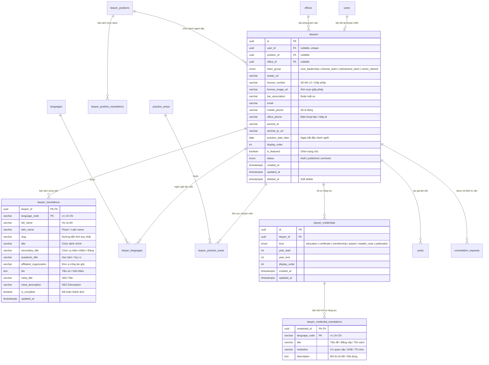

# Thiết Kế Cơ Sở Dữ Liệu Phân Hệ Quản Lý Luật Sư (Lawyer Management)
**Hãng luật Vạn Ích (万益河内律师事务所 - LuatVanIch)**

---

## 1. Tổng quan phân hệ

Phân hệ **Quản lý Luật sư (`lawyers`)** là một trong những thành phần cốt lõi của website Hãng luật Vạn Ích. Phân hệ được thiết kế theo các tiêu chuẩn:
- **Chuẩn hóa 3NF**: Phân tách rõ ràng giữa dữ liệu đơn trị, đa trị (ngôn ngữ, chuyên môn), và dữ liệu chuẩn danh mục (chức danh, văn phòng).
- **Kiến trúc song ngữ độc lập (`vi` và `zh-CN`)**: Tách biệt giữa thuộc tính phi ngôn ngữ (ảnh, số điện thoại, ngày vào nghề, thứ tự) và thuộc tính phụ thuộc ngôn ngữ (họ tên, chức danh, tiểu sử, SEO).
- **Đặc thù hãng luật xuyên biên giới Việt – Trung**: 
  - Phân nhóm đội ngũ rõ ràng (Lãnh đạo cốt lõi, Luật sư Trung Quốc, Luật sư đối tác Việt Nam, Chuyên gia cố vấn).
  - Hỗ trợ tên phiên âm Pinyin / Latin song song chữ Hán và tiếng Việt.
  - Quản lý học hàm, học vị danh giá (Giáo sư, Tiến sĩ, Luật sư cấp 1 - 一级律师).
  - Quản lý thẩm quyền tài phán, giấy phép hành nghề của Bộ Tư pháp Việt Nam / Trung Quốc, trọng tài viên quốc tế.
  - Quản lý công trình nghiên cứu, sách chuyên khảo và bài báo khoa học pháp lý (`publication`).

---

## 2. Sơ đồ Quan hệ Thực thể (ERD)



---

## 3. Danh mục các Kiểu dữ liệu Enum (Custom Types)

### 3.1 `lawyer_team_group` (Phân nhóm đội ngũ luật sư)
Xác định vị trí phân loại của nhân sự trong cơ cấu tổ chức và hiển thị tab trên giao diện:
- `core_leadership`: Ban Lãnh đạo cốt lõi / Luật sư sáng lập (ví dụ: Chủ nhiệm Lăng Thần, Chủ nhiệm Lăng Bân).
- `chinese_team`: Đội ngũ luật sư Trung Quốc (chuyên trách xuyên biên giới, có giấy phép hành nghề tại VN).
- `vietnamese_team`: Đội ngũ luật sư đối tác Việt Nam (luật sư tranh tụng, đối tác bản địa).
- `senior_advisor`: Ban Cố vấn cấp cao & Đối ngoại (chuyên gia kinh tế, tiến sĩ, cố vấn chiến lược).

### 3.2 `credential_kind` (Loại bằng cấp, chứng chỉ, hồ sơ năng lực)
- `education`: Quá trình đào tạo, học vấn (Cử nhân, Thạc sĩ, Tiến sĩ, Du học).
- `certificate`: Chứng chỉ hành nghề luật sư, thẻ luật sư, chứng chỉ tài chính/ngân hàng/trọng tài.
- `membership`: Thành viên tổ chức, đoàn luật sư, hiệp hội doanh nghiệp, chính hiệp, hòa giải viên.
- `award`: Giải thưởng, danh hiệu thi đua (Luật sư xuất sắc, Bằng khen của Bộ Tư pháp).
- `notable_case`: Vụ việc, dự án đầu tư tiêu biểu đã giải quyết thành công.
- `publication`: Sách chuyên khảo, công trình nghiên cứu, bài báo khoa học pháp lý đã công bố.

### 3.3 `content_status` (Trạng thái xuất bản)
- `draft`: Bản nháp, chưa công khai trên website.
- `published`: Đã xuất bản, hiển thị công khai trên website.
- `archived`: Đã lưu trữ / Tạm ẩn khỏi website.

---

## 4. Chi tiết cấu trúc các Bảng dữ liệu

### 4.1 Bảng `lawyers` (Dữ liệu chung của Luật sư)
Lưu trữ toàn bộ thông tin định danh, liên hệ, hành chính và thống kê phi ngôn ngữ.

| Tên cột | Kiểu dữ liệu | Nullable | Mặc định | Mô tả & Ràng buộc |
|---|---|---|---|---|
| `id` | `uuid` | NO | `gen_random_uuid()` | Khóa chính (PK) |
| `user_id` | `uuid` | YES | `NULL` | FK $\rightarrow$ `users(id)`, UNIQUE. Cho phép luật sư đăng nhập CMS viết bài / tiếp nhận tư vấn |
| `position_id` | `uuid` | YES | `NULL` | FK $\rightarrow$ `lawyer_positions(id)`. Chức danh chuẩn hóa trong công ty luật |
| `office_id` | `uuid` | YES | `NULL` | FK $\rightarrow$ `offices(id)`. Văn phòng trực thuộc chính (Hà Nội, Sùng Tả, Nam Ninh...) |
| `team_group` | `lawyer_team_group` | NO | `'chinese_team'` | Phân nhóm đội ngũ hiển thị |
| `avatar_url` | `varchar(500)` | YES | `NULL` | Ảnh chân dung chuyên nghiệp (tỷ lệ chuẩn 4:5, kích thước khuyến nghị 800 × 1000px) |
| `license_number` | `varchar(100)` | YES | `NULL` | Số thẻ hành nghề luật sư / Số giấy phép chi nhánh nước ngoài của Bộ Tư pháp |
| `license_image_url`| `varchar(500)` | YES | `NULL` | Link ảnh scan thẻ luật sư / giấy phép hành nghề |
| `bar_association` | `varchar(255)` | YES | `NULL` | Đoàn luật sư / Hiệp hội luật sư trực thuộc (Đoàn LS Quảng Ninh, Đoàn LS Hà Nội, Hiệp hội LS Trung Quốc...) |
| `email` | `citext` | YES | `NULL` | Email công việc chính thức (`@wanyimail.com`) |
| `mobile_phone` | `varchar(50)` | YES | `NULL` | Số điện thoại di động liên hệ |
| `office_phone` | `varchar(50)` | YES | `NULL` | Điện thoại bàn văn phòng kèm mã vùng (ví dụ: `0771-2854880`) |
| `wechat_id` | `varchar(100)` | YES | `NULL` | ID tài khoản WeChat (kênh liên lạc trọng yếu với khách hàng Trung Quốc) |
| `wechat_qr_url` | `varchar(500)` | YES | `NULL` | Đường dẫn ảnh mã QR WeChat để quét kết bạn nhanh |
| `practice_start_date` | `date` | YES | `NULL` | Ngày bắt đầu hành nghề (hệ thống tự động tính số năm kinh nghiệm) |
| `display_order` | `int` | NO | `0` | Thứ tự ưu tiên sắp xếp khi hiển thị danh sách (số nhỏ đứng trước) |
| `is_featured` | `boolean` | NO | `false` | Ghim lên vị trí nổi bật tại Trang chủ (`true` / `false`) |
| `status` | `content_status` | NO | `'draft'` | Trạng thái hiển thị (`draft`, `published`, `archived`) |
| `created_at` | `timestamptz` | NO | `CURRENT_TIMESTAMP` | Thời điểm tạo bản ghi (UTC) |
| `updated_at` | `timestamptz` | NO | `CURRENT_TIMESTAMP` | Thời điểm cập nhật cuối cùng (UTC) |
| `deleted_at` | `timestamptz` | YES | `NULL` | Thời điểm xóa mềm (Soft Delete) |

**Chỉ mục (Indexes):**
- `idx_lawyers_user_id`: Index trên `user_id` (Unique).
- `idx_lawyers_position_id`: Index trên `position_id`.
- `idx_lawyers_office_id`: Index trên `office_id`.
- `idx_lawyers_team_group`: Index trên `team_group` để tối ưu lọc theo nhóm.
- `idx_lawyers_status_featured`: Composite index `(status, is_featured, display_order)` phục vụ truy vấn trang chủ.

---

### 4.2 Bảng `lawyer_translations` (Bản dịch thông tin Luật sư)
Lưu trữ thông tin văn bản theo từng ngôn ngữ (`vi` và `zh-CN`).

| Tên cột | Kiểu dữ liệu | Nullable | Mặc định | Mô tả & Ràng buộc |
|---|---|---|---|---|
| `lawyer_id` | `uuid` | NO | — | Khóa chính kép (PK, FK $\rightarrow$ `lawyers(id)` ON DELETE CASCADE) |
| `language_code` | `varchar(10)` | NO | — | Khóa chính kép (PK, giá trị: `vi` hoặc `zh-CN`) |
| `full_name` | `varchar(200)` | NO | — | Họ tên luật sư theo ngôn ngữ (Tiếng Việt: *Nguyễn Văn A*; Tiếng Trung: *凌斌*) |
| `latin_name` | `varchar(150)` | YES | `NULL` | Tên phiên âm quốc tế / Pinyin (ví dụ: *Ling Bin*, *Ling Chen*, *Le Chi Chinh*) |
| `slug` | `varchar(220)` | NO | — | Đường dẫn URL duy nhất (ví dụ: `luat-su-nguyen-van-a`, `ling-bin`) |
| `title` | `varchar(200)` | YES | `NULL` | Chức danh hiển thị chính (ví dụ: *Luật sư điều hành / 执行合伙人*) |
| `secondary_title` | `varchar(200)` | YES | `NULL` | Chức vụ kiêm nhiệm / Chức vụ Đảng / Đoàn thể (ví dụ: *Bí thư Đảng ủy / 党委书记*) |
| `academic_title` | `varchar(150)` | YES | `NULL` | Học hàm, học vị, cấp bậc (ví dụ: *Tiến sĩ Luật*, *Luật sư cấp 1 - 一级律师*, *GS.TS*) |
| `affiliated_organization` | `varchar(255)` | YES | `NULL` | Đơn vị công tác chính / Hãng luật hợp tác (ví dụ: *Viễn Dương Legal*, *ĐHQGHN*) |
| `bio` | `text` | YES | `NULL` | Tiểu sử tóm tắt quá trình hoạt động và phong cách hành nghề |
| `meta_title` | `varchar(70)` | YES | `NULL` | Thẻ tiêu đề SEO Google |
| `meta_description` | `varchar(160)` | YES | `NULL` | Thẻ mô tả SEO Google |
| `is_complete` | `boolean` | NO | `false` | Đánh dấu bản dịch của ngôn ngữ này đã hoàn thành đầy đủ hay chưa |
| `updated_at` | `timestamptz` | NO | `CURRENT_TIMESTAMP` | Thời điểm cập nhật bản dịch |

**Chỉ mục (Indexes):**
- `pk_lawyer_translations`: Khóa chính kép `(lawyer_id, language_code)`.
- `idx_lawyer_translations_slug`: Unique index trên `(slug, language_code)`.
- `idx_lawyer_translations_search`: Full-text search index (GIN) trên `(full_name, latin_name, bio)`.

---

### 4.3 Bảng `lawyer_positions` & `lawyer_position_translations` (Chức danh ngạch bậc)
Chuẩn hóa các chức danh như: *Chủ nhiệm (主任), Giám đốc điều hành (执行主任), Thành viên góp vốn (合伙人), Luật sư cao cấp (高级律师), Luật sư cộng sự (专职律师), Cố vấn cao cấp (高级顾问)*.

#### Bảng `lawyer_positions`:
- `id`: `uuid` PK
- `code`: `varchar(50)` UNIQUE (ví dụ: `managing_partner`, `partner`, `senior_associate`, `advisor`)
- `display_order`: `int` DEFAULT `0`
- `created_at`, `updated_at`: `timestamptz`

#### Bảng `lawyer_position_translations`:
- `position_id`: `uuid` PK, FK $\rightarrow$ `lawyer_positions(id)` ON DELETE CASCADE
- `language_code`: `varchar(10)` PK (`vi` hoặc `zh-CN`)
- `name`: `varchar(100)` NOT NULL (ví dụ: *Luật sư Thành viên / 合伙人*)
- `description`: `text`

---

### 4.4 Bảng nối `lawyer_languages` (Ngôn ngữ làm việc)
Quan hệ nhiều - nhiều giữa `lawyers` và danh mục ngôn ngữ (`languages`):
- `lawyer_id`: `uuid` PK, FK $\rightarrow$ `lawyers(id)` ON DELETE CASCADE
- `language_code`: `varchar(10)` PK, FK $\rightarrow$ `languages(code)` (ví dụ: `vi`, `zh`, `en`)
- `is_native`: `boolean` DEFAULT `false` (Ngôn ngữ mẹ đẻ)

---

### 4.5 Bảng nối `lawyer_practice_areas` (Lĩnh vực chuyên môn)
Quan hệ nhiều - nhiều giữa `lawyers` và danh mục lĩnh vực pháp lý (`practice_areas`):
- `lawyer_id`: `uuid` PK, FK $\rightarrow$ `lawyers(id)` ON DELETE CASCADE
- `practice_area_id`: `uuid` PK, FK $\rightarrow$ `practice_areas(id)` ON DELETE CASCADE
- `is_primary`: `boolean` DEFAULT `false` (Lĩnh vực chuyên sâu trọng tâm)
- `display_order`: `int` DEFAULT `0`

---

### 4.6 Bảng `lawyer_credentials` & `lawyer_credential_translations` (Lý lịch, Bằng cấp & Ấn phẩm)
Lưu chi tiết các mốc học vấn, thẻ hành nghề, giải thưởng, vụ việc tiêu biểu và công trình sách báo.

#### Bảng `lawyer_credentials`:
| Tên cột | Kiểu dữ liệu | Nullable | Mặc định | Mô tả |
|---|---|---|---|---|
| `id` | `uuid` | NO | `gen_random_uuid()` | Khóa chính (PK) |
| `lawyer_id` | `uuid` | NO | — | FK $\rightarrow$ `lawyers(id)` ON DELETE CASCADE |
| `kind` | `credential_kind` | NO | — | Loại thông tin: `education`, `certificate`, `membership`, `award`, `notable_case`, `publication` |
| `year_start` | `int` | YES | `NULL` | Năm bắt đầu (hoặc năm công bố ấn phẩm) |
| `year_end` | `int` | YES | `NULL` | Năm kết thúc (để trống nếu đang tiếp diễn) |
| `display_order` | `int` | NO | `0` | Thứ tự hiển thị trong cùng một nhóm `kind` |
| `created_at` | `timestamptz` | NO | `CURRENT_TIMESTAMP` | Thời điểm tạo |
| `updated_at` | `timestamptz` | NO | `CURRENT_TIMESTAMP` | Thời điểm cập nhật |

#### Bảng `lawyer_credential_translations`:
| Tên cột | Kiểu dữ liệu | Nullable | Mô tả |
|---|---|---|---|
| `credential_id` | `uuid` | NO | PK, FK $\rightarrow$ `lawyer_credentials(id)` ON DELETE CASCADE |
| `language_code` | `varchar(10)` | NO | PK (`vi` hoặc `zh-CN`) |
| `title` | `varchar(255)` | NO | Tên bằng cấp / Chứng chỉ / Tên giải thưởng / Tiêu đề sách báo công trình |
| `institution` | `varchar(255)` | YES | Tên trường đại học / Cơ quan cấp bằng / Tạp chí / Nhà xuất bản |
| `description` | `text` | YES | Chi tiết kết quả học tập / Nội dung vụ việc / Tóm tắt công trình khoa học |

---

## 5. Các giá trị Dẫn xuất (Tự động tính, không lưu cứng)

| Giá trị dẫn xuất | Cách truy vấn / tính toán | Mục đích sử dụng |
|---|---|---|
| **Số năm kinh nghiệm** | `EXTRACT(YEAR FROM age(CURRENT_DATE, practice_start_date))` | Hiển thị badge: *"15+ năm kinh nghiệm"* |
| **Dịch vụ phụ trách** | `SELECT * FROM services WHERE practice_area_id IN (SELECT practice_area_id FROM lawyer_practice_areas WHERE lawyer_id = ...)` | Hiển thị danh sách dịch vụ tại trang chi tiết luật sư |
| **Bài viết của luật sư** | `SELECT * FROM posts WHERE author_lawyer_id = ... AND status = 'published'` | Khối *"Bài viết do luật sư xuất bản"* |
| **Yêu cầu tư vấn chỉ định**| `SELECT * FROM consultation_requests WHERE lawyer_id = ...` | Thống kê số lượng khách hàng đặt lịch trực tiếp với luật sư |

---

## 6. Mẫu DDL PostgreSQL (SQL Migration Script)

```sql
-- 1. TẠO CÁC ENUM
CREATE TYPE lawyer_team_group AS ENUM (
    'core_leadership',
    'chinese_team',
    'vietnamese_team',
    'senior_advisor'
);

CREATE TYPE credential_kind AS ENUM (
    'education',
    'certificate',
    'membership',
    'award',
    'notable_case',
    'publication'
);

-- (content_status đã được định nghĩa từ hệ thống: 'draft', 'published', 'archived')

-- 2. TẠO BẢNG CHÍNH LAWYERS
CREATE TABLE lawyers (
    id UUID PRIMARY KEY DEFAULT gen_random_uuid(),
    user_id UUID UNIQUE REFERENCES users(id) ON DELETE SET NULL,
    position_id UUID REFERENCES lawyer_positions(id) ON DELETE SET NULL,
    office_id UUID REFERENCES offices(id) ON DELETE SET NULL,
    team_group lawyer_team_group NOT NULL DEFAULT 'chinese_team',
    avatar_url VARCHAR(500),
    license_number VARCHAR(100),
    license_image_url VARCHAR(500),
    bar_association VARCHAR(255),
    email CITEXT,
    mobile_phone VARCHAR(50),
    office_phone VARCHAR(50),
    wechat_id VARCHAR(100),
    wechat_qr_url VARCHAR(500),
    practice_start_date DATE,
    display_order INT NOT NULL DEFAULT 0,
    is_featured BOOLEAN NOT NULL DEFAULT false,
    status content_status NOT NULL DEFAULT 'draft',
    created_at TIMESTAMPTZ NOT NULL DEFAULT CURRENT_TIMESTAMP,
    updated_at TIMESTAMPTZ NOT NULL DEFAULT CURRENT_TIMESTAMP,
    deleted_at TIMESTAMPTZ
);

CREATE INDEX idx_lawyers_position ON lawyers(position_id);
CREATE INDEX idx_lawyers_office ON lawyers(office_id);
CREATE INDEX idx_lawyers_team_group ON lawyers(team_group);
CREATE INDEX idx_lawyers_featured_order ON lawyers(status, is_featured, display_order);

-- 3. TẠO BẢNG BẢN DỊCH LAWYER_TRANSLATIONS
CREATE TABLE lawyer_translations (
    lawyer_id UUID NOT NULL REFERENCES lawyers(id) ON DELETE CASCADE,
    language_code VARCHAR(10) NOT NULL,
    full_name VARCHAR(200) NOT NULL,
    latin_name VARCHAR(150),
    slug VARCHAR(220) NOT NULL,
    title VARCHAR(200),
    secondary_title VARCHAR(200),
    academic_title VARCHAR(150),
    affiliated_organization VARCHAR(255),
    bio TEXT,
    meta_title VARCHAR(70),
    meta_description VARCHAR(160),
    is_complete BOOLEAN NOT NULL DEFAULT false,
    updated_at TIMESTAMPTZ NOT NULL DEFAULT CURRENT_TIMESTAMP,
    CONSTRAINT pk_lawyer_translations PRIMARY KEY (lawyer_id, language_code),
    CONSTRAINT uq_lawyer_slug UNIQUE (slug, language_code)
);

CREATE INDEX idx_lawyer_translations_slug ON lawyer_translations(slug);

-- 4. BẢNG NỐI NGÔN NGỮ LÀM VIỆC
CREATE TABLE lawyer_languages (
    lawyer_id UUID NOT NULL REFERENCES lawyers(id) ON DELETE CASCADE,
    language_code VARCHAR(10) NOT NULL,
    is_native BOOLEAN NOT NULL DEFAULT false,
    CONSTRAINT pk_lawyer_languages PRIMARY KEY (lawyer_id, language_code)
);

-- 5. BẢNG NỐI LĨNH VỰC CHUYÊN MÔN
CREATE TABLE lawyer_practice_areas (
    lawyer_id UUID NOT NULL REFERENCES lawyers(id) ON DELETE CASCADE,
    practice_area_id UUID NOT NULL REFERENCES practice_areas(id) ON DELETE CASCADE,
    is_primary BOOLEAN NOT NULL DEFAULT false,
    display_order INT NOT NULL DEFAULT 0,
    CONSTRAINT pk_lawyer_practice_areas PRIMARY KEY (lawyer_id, practice_area_id)
);

-- 6. BẢNG HỒ SƠ NĂNG LỰC / BẰNG CẤP / CÔNG TRÌNH KHOA HỌC
CREATE TABLE lawyer_credentials (
    id UUID PRIMARY KEY DEFAULT gen_random_uuid(),
    lawyer_id UUID NOT NULL REFERENCES lawyers(id) ON DELETE CASCADE,
    kind credential_kind NOT NULL,
    year_start INT,
    year_end INT,
    display_order INT NOT NULL DEFAULT 0,
    created_at TIMESTAMPTZ NOT NULL DEFAULT CURRENT_TIMESTAMP,
    updated_at TIMESTAMPTZ NOT NULL DEFAULT CURRENT_TIMESTAMP
);

CREATE INDEX idx_lawyer_credentials_lawyer ON lawyer_credentials(lawyer_id, kind);

-- 7. BẢN DỊCH HỒ SƠ NĂNG LỰC
CREATE TABLE lawyer_credential_translations (
    credential_id UUID NOT NULL REFERENCES lawyer_credentials(id) ON DELETE CASCADE,
    language_code VARCHAR(10) NOT NULL,
    title VARCHAR(255) NOT NULL,
    institution VARCHAR(255),
    description TEXT,
    CONSTRAINT pk_lawyer_credential_translations PRIMARY KEY (credential_id, language_code)
);
```

---

## 7. Ghi chú triển khai Backend & Frontend

1. **Backend NestJS**:
   - Sử dụng quan hệ `@OneToMany` từ `Lawyer` sang `LawyerTranslation` với `cascade: true`.
   - Tạo virtual getter `get experienceYears(): number | null` trong Entity hoặc DTO response để tự động tính tuổi nghề.
   - Khi tạo mới một hồ sơ luật sư, hệ thống yêu cầu ít nhất bản dịch của ngôn ngữ mặc định (`vi` hoặc `zh-CN`), kèm cơ chế slugify tự động từ `full_name`.
2. **Frontend Next.js (Admin CMS & Public Website)**:
   - **Public Website (`/lawyers`)**: Có thanh Tab chia theo `team_group` (*Ban Lãnh đạo | Đội ngũ Trung Quốc | Đội ngũ Đối tác Việt Nam | Ban Cố vấn*) kèm bộ lọc theo chuyên môn và ngôn ngữ.
   - **Thẻ Luật sư**: Hiển thị ảnh 4:5, `full_name`, `latin_name` (Pinyin), `title` + `secondary_title`, `academic_title` và biểu tượng ngôn ngữ (`VI · 中文 · EN`).
   - **Admin CMS (`/admin/lawyers`)**: Form quản trị có Tab chuyển đổi giữa Thông tin cơ bản, Dịch thuật (`vi` / `zh-CN`), Danh mục chuyên môn, và Danh sách Bằng cấp/Công trình nghiên cứu.
