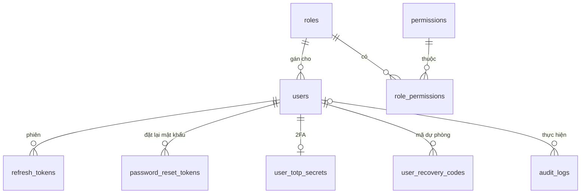
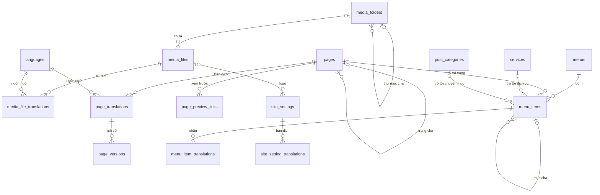
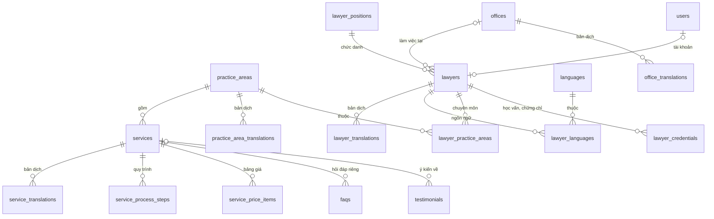
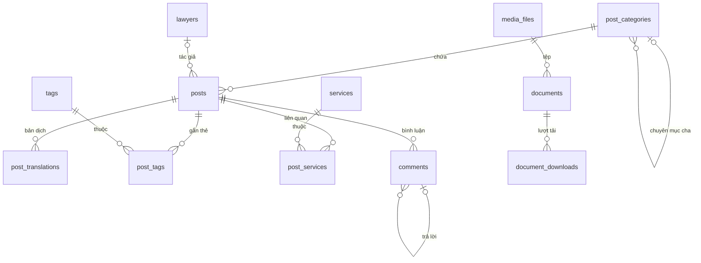
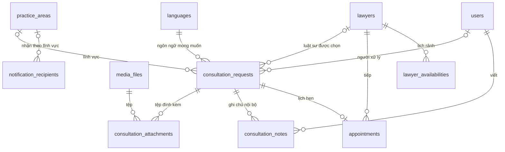

# Thiết kế cơ sở dữ liệu – Website công ty luật và bộ công cụ kéo thả

> Phạm vi: dựa trên danh sách chức năng ở mục 1.3 của *Bản thu thập yêu cầu* (nhóm A–G).
> Hệ quản trị: **PostgreSQL 15+** · ORM: **Prisma** (NestJS) · Phiên bản tài liệu: 1.0 · Ngày lập: 09/11/2026

## Mục lục

1. [Tổng quan và quy ước](#1-tổng-quan-và-quy-ước)
2. [Nguyên tắc chuẩn hóa 3NF và dữ liệu dẫn xuất](#2-nguyên-tắc-chuẩn-hóa-3nf-và-dữ-liệu-dẫn-xuất)
3. [Kiểu liệt kê (enum)](#3-kiểu-liệt-kê-enum)
4. [Lược đồ quan hệ (ER)](#4-lược-đồ-quan-hệ-er)
5. [Chi tiết các bảng](#5-chi-tiết-các-bảng)
   - 5.A Ngôn ngữ và cấu hình hệ thống
   - 5.B Người dùng và bảo mật
   - 5.C Thư viện media
   - 5.D Trang và trình kéo thả
   - 5.E Menu và giao diện (theme)
   - 5.F Giới thiệu doanh nghiệp
   - 5.G Lĩnh vực và dịch vụ pháp lý
   - 5.H Luật sư và văn phòng
   - 5.I Bài viết, tài liệu, bản tin
   - 5.J Yêu cầu tư vấn và đặt lịch
6. [Ánh xạ chức năng sang bảng](#6-ánh-xạ-chức-năng-sang-bảng)
7. [Chỉ mục, ràng buộc nâng cao và ghi chú Prisma](#7-chỉ-mục-ràng-buộc-nâng-cao-và-ghi-chú-prisma)
8. [Dữ liệu khởi tạo (seed)](#8-dữ-liệu-khởi-tạo-seed)

---

## 1. Tổng quan và quy ước

Cơ sở dữ liệu có **khoảng 80 bảng** chia thành 10 nhóm. Phần lớn nội dung hiển thị cho khách (trang, bài viết, dịch vụ, luật sư...) cần **song ngữ Việt/Trung**, nên được tách thành hai bảng: bảng chính chứa dữ liệu dùng chung mọi ngôn ngữ, bảng `*_translations` chứa chữ theo từng ngôn ngữ.

### 1.1 Quy ước đặt tên và kiểu dữ liệu

| Quy ước | Nội dung |
|---|---|
| Tên bảng, tên cột | `snake_case`, tiếng Anh, tên bảng ở dạng số nhiều (`lawyers`) |
| Khóa chính | `id uuid DEFAULT gen_random_uuid()`, trừ khi ghi khác |
| Khóa ngoại | `<tên_bảng_số_ít>_id` (ví dụ `lawyer_id`), đánh chỉ mục |
| Bảng dịch | `<bảng>_translations`, khóa chính kép `(<bảng>_id, language_code)` |
| Thời gian | `timestamptz` (lưu UTC, hiển thị theo múi giờ `Asia/Ho_Chi_Minh`) |
| Văn bản dài | `text`; văn bản có giới hạn rõ dùng `varchar(n)` |
| Tiền | `numeric(14,2)`, kèm mã tiền tệ `char(3)` |
| Email | `citext` (không phân biệt hoa thường), cần extension `citext` |
| Địa chỉ IP | `inet` |

### 1.2 Nhóm cột chung (viết tắt trong phần mô tả bảng)

| Ký hiệu | Gồm các cột | Dùng cho |
|---|---|---|
| **[A]** | `created_at timestamptz NOT NULL DEFAULT now()`, `updated_at timestamptz NOT NULL`, `created_by uuid → users.id`, `updated_by uuid → users.id` | Bảng nội dung do quản trị viên tạo và sửa |
| **[T]** | `created_at`, `updated_at` | Bảng cần dấu thời gian, không cần biết ai sửa |
| **[—]** | Không có cột chung | Bảng ghi nhận sự kiện, bảng nối, bảng tra cứu |

Trong bảng dịch, `updated_at` và `updated_by` được ghi khi sửa bản dịch (ký hiệu **[A]** áp dụng tương tự, ghi rõ khi khác).

### 1.3 Cách hoạt động của song ngữ

- Bảng `languages` liệt kê ngôn ngữ (`vi`, `zh-CN`, `en`). Ngôn ngữ mặc định là tiếng Việt.
- Khi khách mở trang bằng tiếng Trung mà chưa có bản dịch (hoặc `is_complete = false`), ứng dụng quay về bản tiếng Việt (câu hỏi 4.2.6 của bản yêu cầu cần khách chốt).
- `slug` (đường dẫn) nằm trong bảng dịch vì mỗi ngôn ngữ có đường dẫn riêng, phục vụ SEO và thẻ `hreflang`.

---

## 2. Nguyên tắc chuẩn hóa 3NF và dữ liệu dẫn xuất

### 2.1 Các quy tắc đã áp dụng

| Dạng chuẩn | Cách đạt được trong thiết kế |
|---|---|
| **1NF** | Mọi cột chỉ chứa giá trị đơn. Thuộc tính nhiều giá trị (ngôn ngữ của luật sư, lĩnh vực chuyên môn, thẻ bài viết, quyền của vai trò) tách thành bảng nối. Không dùng cột dạng `lang1, lang2` hoặc chuỗi phân tách bằng dấu phẩy |
| **2NF** | Bảng có khóa kép (`*_translations`, bảng nối) chỉ chứa cột phụ thuộc vào **toàn bộ** khóa. Dữ liệu chung mọi ngôn ngữ nằm ở bảng chính, không lặp lại trong bảng dịch |
| **3NF** | Không có cột phụ thuộc bắc cầu vào khóa chính qua cột không khóa. Ví dụ: chức danh luật sư tách thành `lawyer_positions`, văn phòng tách thành `offices`, lĩnh vực tách thành `practice_areas` thay vì lưu chữ lặp lại trong `lawyers`. Bảng `consultation_requests` chỉ lưu `practice_area_id`, không lưu thêm dịch vụ suy ra lĩnh vực |

### 2.2 Dữ liệu dẫn xuất **không** lưu

Các giá trị sau luôn tính ra khi truy vấn, không có cột riêng:

| Giá trị | Cách có được |
|---|---|
| Số năm kinh nghiệm của luật sư | Tính từ `lawyers.practice_start_date` đến ngày hiện tại |
| Thời gian đọc ước tính của bài viết | Đếm từ trong `post_translations.content_html` khi hiển thị |
| Mục lục tự động của bài viết | Trích các thẻ tiêu đề trong nội dung khi hiển thị |
| Số bình luận, số lượt tải tài liệu, số yêu cầu tư vấn theo tuần/tháng | `COUNT` từ `comments`, `document_downloads`, `consultation_requests` |
| Luật sư phụ trách một dịch vụ | Luật sư có chung `practice_area_id` với dịch vụ (qua `lawyer_practice_areas`) |
| Bài viết liên quan | Cùng chuyên mục hoặc chung thẻ; liên kết chọn tay nằm ở `post_services` |
| Đường dẫn phân cấp (breadcrumb) | Dựng từ `pages.parent_page_id`, `post_categories.parent_id`, `menu_items` |
| Tài khoản bị khóa tạm do đăng nhập sai nhiều lần | Đếm `login_attempts` thất bại gần đây theo email và IP |
| Lần đăng nhập gần nhất của người dùng | Lấy bản ghi mới nhất trong `login_attempts` hoặc `refresh_tokens` |
| Trạng thái "đã lên lịch" đã đến giờ chưa | So `publish_at` với giờ hiện tại; tác vụ định kỳ đổi `status` |
| Chỉ mục tìm kiếm toàn văn (`tsvector`) | Chỉ mục biểu thức (GIN) trên cột chữ, không có cột riêng |
| Thứ tự hiển thị mặc định theo tên hoặc ngày | Sắp xếp khi truy vấn |
| CSS biến màu của theme | Sinh từ các cột màu của `themes` khi render |

### 2.3 Các chỗ châm chước có chủ đích

| Chỗ | Lý do chấp nhận |
|---|---|
| Cột `content_json` (JSONB) của trang, dịch vụ, mẫu trang, khối đã lưu | Đây là dữ liệu của trình kéo thả (cấu trúc cây khối, thuộc tính mỗi khối thay đổi theo loại khối). Lưu dạng tài liệu là thiết kế đúng cho dữ liệu này. Lược đồ được kiểm tra ở tầng ứng dụng (zod) |
| `page_versions.content_json` | Ảnh chụp lịch sử tại một thời điểm, cố ý lưu lại bản cũ để khôi phục. Không phải dữ liệu lặp cần đồng bộ |
| `audit_logs.entity_type` + `entity_id` | Tham chiếu đa hình tới nhiều bảng nên không đặt khóa ngoại. Bản ghi nhật ký phải sống sót khi dòng nguồn bị xóa |
| `site_settings` chỉ có một dòng (singleton) | Cấu hình toàn site; ràng buộc `CHECK (id = 1)` bảo đảm đúng một dòng |
| `stat_items.figure` (số liệu nổi bật như 10+ năm, 1000+ hồ sơ) | Là con số quảng bá do admin nhập tay (có thể làm tròn như "1000+"), không tính ra từ dữ liệu hệ thống |
| `media_files.width_px`, `height_px`, `size_bytes` | Thuộc tính của tệp gốc, đọc lúc tải lên; không suy ra từ cột khác |
| `status` (nháp, chờ duyệt, đã lên lịch, đã đăng...) đi cùng `publish_at` | Là hai thông tin khác nhau: trạng thái quy trình duyệt do người dùng đặt, còn `publish_at` là thời điểm đăng |

---

## 3. Kiểu liệt kê (enum)

| Tên enum | Giá trị | Dùng ở |
|---|---|---|
| `content_status` | `draft`, `in_review`, `scheduled`, `published`, `archived` | pages, posts, services, lawyers |
| `page_type` | `home`, `static`, `system`, `landing`, `legal` | pages |
| `contact_channel_type` | `hotline`, `email`, `zalo`, `messenger`, `wechat`, `facebook`, `youtube`, `linkedin`, `tiktok`, `other` | contact_channels |
| `tracking_provider` | `ga4`, `gtm`, `search_console`, `fb_pixel`, `baidu_tongji` | tracking_integrations |
| `notify_channel` | `email`, `zalo`, `telegram` | notification_recipients |
| `credential_kind` | `education`, `certificate`, `membership`, `award`, `notable_case` | lawyer_credentials |
| `billing_type` | `fixed`, `hourly`, `per_case`, `quote_on_request` | service_price_items |
| `post_section` | `news`, `handbook`, `knowledge_base` | post_categories |
| `comment_status` | `pending`, `approved`, `rejected`, `spam` | comments |
| `lead_status` | `new`, `in_progress`, `done`, `spam` | consultation_requests |
| `contact_preference` | `phone`, `email`, `zalo`, `wechat` | consultation_requests |
| `radius_style` | `square`, `soft`, `round` | themes |
| `button_style` | `solid`, `outline`, `pill` | themes |
| `card_style` | `bordered`, `shadow`, `flat` | themes |
| `color_mode` | `light`, `dark`, `system` | themes |
| `motion_level` | `none`, `light`, `medium` | themes |
| `header_variant` | `logo_left`, `logo_center`, `utility_bar` | themes |
| `footer_variant` | `four_columns`, `dark_three_columns`, `minimal` | themes |
| `floating_variant` | `side_column`, `bottom_bar`, `expandable` | themes |
| `floating_position` | `left`, `right` | themes |

---

## 4. Lược đồ quan hệ (ER)

Sơ đồ chia theo nhóm cho dễ đọc. Ký hiệu: `||` đúng một, `|o` không hoặc một, `o{` không hoặc nhiều, `|{` một hoặc nhiều. Mỗi bảng chính có thêm bảng dịch `*_translations` (bảng nội dung có song ngữ), không vẽ lại trong từng sơ đồ trừ khi cần.

### 4.1 Người dùng và bảo mật

### 4.2 Media, trang, menu, theme

### 4.3 Lĩnh vực, dịch vụ, luật sư

### 4.4 Bài viết và tài liệu

### 4.5 Yêu cầu tư vấn và đặt lịch

---
