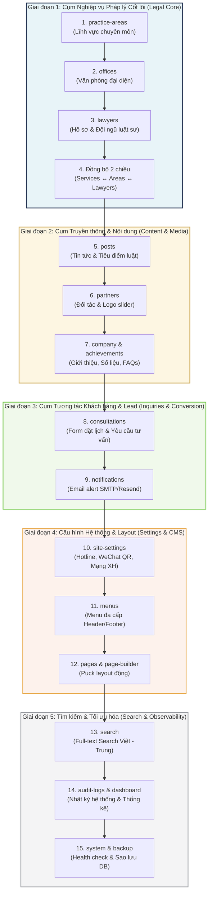

# Lộ Trình & Thứ Tự Triển Khai Các Module Backend (luatvanich_be)
**Hãng luật Vạn Ích (万益河内律师事务所 - LuatVanIch)**

---

## 1. Nguyên tắc sắp xếp thứ tự triển khai

Thứ tự xây dựng các module backend được thiết kế dựa trên **Ma trận phụ thuộc dữ liệu (Data Dependency Graph)** và **Tiêu chuẩn 3NF**:
1. **Dependency First (Khóa ngoại đi trước)**: Các bảng danh mục độc lập được tạo trước $\rightarrow$ Các bảng trung gian / liên kết $\rightarrow$ Các bảng nghiệp vụ cốt lõi $\rightarrow$ Các bảng tương tác người dùng / lead / báo cáo.
2. **Không Mock ID / Không tạo nợ kỹ thuật (Zero Technical Debt)**: Tránh việc tạo entity nhưng phải comment hoặc để tạm `nullable` các khóa ngoại quan trọng.
3. **Độc lập song ngữ (`vi` & `zh-CN`)**: Mỗi module nội dung đều tuân thủ kiến trúc tách bảng `*_translations` với khóa chính kép `(entity_id, language_code)`.

---

## 2. Bản đồ Trạng thái Hiện tại (Current Progress)

```
[Hoàn thành 100%]
├── auth          (JWT, Refresh Token, Đổi mật khẩu, Profile)
├── users         (CRUD tài khoản, Active/Inactive Switch, Gán Role)
├── roles         (RBAC, Phân quyền chi tiết 4 cấp độ)
├── media         (Cloudinary Integration, Upload ảnh, Quản lý tệp)
└── legal-services (Dịch vụ pháp lý cơ bản - services, service_translations)
```

> [!NOTE]
> Trong `LegalService.entity.ts`, trường `practiceAreaId` hiện đang để tạm `nullable` vì chưa có bảng `practice_areas`. Do đó, bước tiếp theo cần giải quyết ngay gốc rễ này.

---

## 3. Lộ trình chi tiết từng Giai đoạn (Phases & Sprints)



---

### Giai đoạn 1: Cụm Nghiệp vụ Pháp lý Cốt lõi (Legal Core Subsystem)
*Mục tiêu: Hoàn thiện toàn bộ tam giác dữ liệu: **Lĩnh vực ↔ Dịch vụ ↔ Luật sư ↔ Văn phòng**.*

#### 1. `practice-areas` (M15 🌐 - Lĩnh vực chuyên môn)
- **Entities**: `PracticeArea`, `PracticeAreaTranslation`.
- **Dữ liệu**: Đầu tư FDI, M&A & Tái cấu trúc, Bất động sản & Xây dựng, Tranh chấp thương mại, Sở hữu trí tuệ, Lao động & Thuế...
- **API**:
  - Public: `GET /practice-areas`, `GET /practice-areas/:slug`
  - Admin: CRUD đầy đủ, `PATCH /admin/practice-areas/reorder`.
- **Ý nghĩa**: Cung cấp khóa ngoại FK cho cả `services` và `lawyers`.

#### 2. `offices` (M18 🌐 - Văn phòng đại diện)
- **Entities**: `Office`, `OfficeTranslation`.
- **Dữ liệu**: Hà Nội (trụ sở chính), Bắc Ninh, Sùng Tả, Nam Ninh, TP.HCM... kèm tọa độ Google Maps, hotline, mã QR WeChat, giờ làm việc.
- **API**:
  - Public: `GET /offices`, `GET /offices/:id`
  - Admin: CRUD văn phòng, quản lý ảnh đại diện, bản đồ.
- **Ý nghĩa**: Cung cấp văn phòng trực thuộc cho luật sư và dữ liệu cho trang Liên hệ.

#### 3. `lawyers` (M17 🌐 - Quản lý Hồ sơ & Đội ngũ Luật sư)
- **Đặc tả chi tiết**: Đã hoàn thiện tài liệu riêng tại [thiet-ke-database-phan-he-luat-su.md](thiet-ke-database-phan-he-luat-su.md).
- **Entities**:
  - `Lawyer`, `LawyerTranslation` (hỗ trợ `latin_name`, `team_group`, `secondary_title`, `academic_title`).
  - `LawyerPosition`, `LawyerPositionTranslation` (chức danh chuẩn hóa).
  - `LawyerCredential`, `LawyerCredentialTranslation` (học vấn, chứng chỉ, giải thưởng, vụ việc tiêu biểu, và **ấn phẩm / bài báo khoa học `publication`**).
  - Bảng nối: `lawyer_languages`, `lawyer_practice_areas`.
- **API**:
  - Public: Danh sách có lọc theo nhóm (`group`), chuyên môn (`area`), ngôn ngữ (`language`), văn phòng (`office`); hồ sơ chi tiết theo `slug`.
  - Admin: CRUD hồ sơ, upload scan giấy phép hành nghề, cấp quyền viết bài.

#### 4. Đồng bộ & Nâng cấp `legal-services`
- Khôi phục liên kết Foreign Key chính thức giữa `LegalService` $\rightarrow$ `PracticeArea`.
- Bổ sung quan hệ suy luận: Lấy danh sách luật sư phụ trách từng dịch vụ (`GET /services/:slug/lawyers`).

---

### Giai đoạn 2: Cụm Truyền thông & Nội dung (Content & Media)
*Mục tiêu: Đưa toàn bộ các khối nội dung truyền thông, tin tức và giới thiệu công ty vào hoạt động.*

#### 5. `posts` (M19 🌐 - Tin tức, Tiêu điểm luật, Cẩm nang & Kho tri thức)
- **Entities**: `Post`, `PostTranslation`, `PostCategory`, `PostCategoryTranslation`, `PostTag`, `PostTagTranslation`.
- **Quan hệ quan trọng**: `posts.author_lawyer_id` $\rightarrow$ `lawyers.id` (Luật sư là tác giả bài viết).
- **API**: CRUD bài viết, danh mục phân cấp, gắn thẻ bài viết, tính toán thời gian đọc ước tính (không lưu cứng).

#### 6. `partners` (M11 - Logo Đối tác & Khách hàng)
- **Entities**: `Partner`.
- **Dữ liệu**: Tên đối tác, logo (Cloudinary), link website, thứ tự hiển thị, slider trang chủ.
- **API**: Admin CRUD + reorder; Public lấy danh sách active cho slider.

#### 7. `company`, `achievements` & `faqs` (M10, M12, M14 🌐 - Giới thiệu & Uy tín)
- **Entities**: `CompanyInfo`, `Achievement`, `Faq`, `FaqTranslation`.
- **Dữ liệu**: Lịch sử hình thành Vạn Ích (1996 - nay), số liệu nổi bật (*10+ năm, 1000+ hồ sơ, 100% song ngữ Trung - Việt*), các câu hỏi thường gặp khi đầu tư vào Việt Nam.

---

### Giai đoạn 3: Cụm Tương tác Khách hàng & Lead (Inquiries & Conversion)
*Mục tiêu: Thu thập yêu cầu tư vấn, đặt lịch hẹn và kích hoạt chuyển đổi bán dịch vụ.*

#### 8. `consultations` (M25 - Tiếp nhận Yêu cầu Tư vấn)
- **Entities**: `ConsultationRequest`.
- **Dữ liệu**: Họ tên khách, số điện thoại, email, WeChat ID, công ty, nội dung yêu cầu, lĩnh vực cần tư vấn (`practice_area_id`), luật sư chỉ định (`lawyer_id` - nullable), trạng thái xử lý (`pending`, `contacted`, `converted`, `rejected`).
- **Bảo mật**: Rate limit (Throttle), Honeypot chống bot spam form.

#### 9. `notifications` (M27 - Thông báo Đa kênh)
- Tự động kích hoạt khi có lead mới từ form tư vấn:
  - Gửi email thông báo cho ban thư ký / admin qua SMTP (Nodemailer) hoặc Resend API.
  - Gửi email xác nhận tiếp nhận tự động cho khách hàng.

---

### Giai đoạn 4: Cấu hình Hệ thống & Trình Dựng Trang (Settings & CMS)
*Mục tiêu: Cho phép Admin tự tùy biến giao diện, menu, header/footer và các trang tùy biến mà không cần lập trình lại.*

#### 10. `site-settings` (M04 - Cấu hình Website Toàn cục)
- **Entities**: `SiteSetting`.
- **Dữ liệu dạng Key-Value / JSON**: Hotline, Email tiếp nhận, Mã QR WeChat công ty, Địa chỉ trụ sở, Link mạng xã hội, Cấu hình SEO mặc định, Mã nhúng Google Analytics / Facebook Pixel.

#### 11. `menus` (M09 🌐 - Cấu trúc Menu Kéo Thả)
- **Entities**: `Menu`, `MenuItem`, `MenuItemTranslation`.
- **Dữ liệu**: Quản lý đa cấp (Header menu, Footer menu cột 1, cột 2), hỗ trợ liên kết nội bộ (trang, dịch vụ, danh mục) hoặc link ngoài.

#### 12. `pages` & `page-builder` (M07, M08 🌐 - Quản lý Trang & Puck CMS)
- Lưu trữ dữ liệu bố cục kéo thả JSON Puck (`content_json`) cho Trang chủ, Giới thiệu, và các trang đích chuyên đề (Landing pages).

---

### Giai đoạn 5: Tìm kiếm, Giám sát & Vận hành (Search & Production Readiness)
*Mục tiêu: Đạt chuẩn hiệu năng cao, bảo mật và sẵn sàng bàn giao vận hành.*

#### 13. `search` (M24 - Tìm kiếm Toàn văn Song ngữ Việt – Trung)
- Sử dụng PostgreSQL Full-Text Search (GIN Index):
  - Tiếng Việt: Đánh chỉ mục không dấu và có dấu.
  - Tiếng Trung: Đánh chỉ mục ký tự Hán qua `pg_trgm` hoặc `zhparser`.
- Tìm kiếm đồng thời trên 3 thực thể: Dịch vụ, Luật sư, Bài viết.

#### 14. `audit-logs` & `dashboard` (M29, M30 - Nhật ký & Thống kê Quản trị)
- Ghi vết mọi hành động nhạy cảm trong CMS (Ai tạo/sửa/xóa bài viết, luật sư, phân quyền).
- Dashboard: Biểu đồ số lượng yêu cầu tư vấn theo tuần/tháng, số bài viết, số luật sư hoạt động.

#### 15. `system` (M31 - Giám sát & Sao lưu)
- Health Check endpoint (`/health` - DB connection, Cloudinary status, Redis).
- Script tự động backup database định kỳ lên Object Storage.

---

## 4. Bảng Tóm tắt Thứ tự Triển khai (Actionable Checklist)

| Thứ tự | Tên Module Backend | Nhóm chức năng | Phụ thuộc khóa ngoại (FK) | Độ ưu tiên |
|:---:|---|---|---|:---:|
| **1** | `practice-areas` 🌐 | Lĩnh vực chuyên môn | *Không có* | **Cao nhất (Next)** |
| **2** | `offices` 🌐 | Văn phòng đại diện | *Không có* | **Cao** |
| **3** | `lawyers` 🌐 | Hồ sơ & Đội ngũ luật sư | `practice-areas`, `offices`, `users` | **Cao** |
| **4** | Nâng cấp `legal-services` | Dịch vụ pháp lý | `practice-areas` | **Cao** |
| **5** | `posts` 🌐 | Bài viết, Tiêu điểm luật | `lawyers` (tác giả), `media` | Trung bình |
| **6** | `partners` | Logo Đối tác | `media` | Trung bình |
| **7** | `company` & `faqs` 🌐 | Giới thiệu & Hỏi đáp | `media` | Trung bình |
| **8** | `consultations` | Đặt lịch & Form tư vấn | `practice-areas`, `lawyers` | Trung bình |
| **9** | `notifications` | Email thông báo lead | `consultations` | Trung bình |
| **10**| `site-settings` | Cấu hình toàn site | `media` (logo, QR) | Trung bình |
| **11**| `menus` 🌐 | Menu Header/Footer | `pages`, `services` | Thấp |
| **12**| `pages` & `page-builder` | Puck Page Builder | `media` | Thấp |
| **13**| `search` | Tìm kiếm toàn site | Dịch vụ, Luật sư, Bài viết | Thấp |
| **14**| `audit-logs` & `dashboard`| Nhật ký & Báo cáo | Toàn hệ thống | Thấp |
| **15**| `system` | Health check & Backup | Toàn hệ thống | Cuối cùng |

---

## 5. Quy chuẩn Kỹ thuật Bắt buộc khi Code Mỗi Module

Khi thực hiện từng module trong danh sách trên, cần tuân thủ 100% cấu trúc chuẩn của dự án:
1. **Thư mục Module**:
   ```
   src/modules/<module-name>/
   ├── dto/
   │   ├── request/     # DTO đầu vào (Validate qua class-validator)
   │   └── response/    # DTO đầu ra (ClassSerializer / Mapper)
   ├── entities/        # TypeORM entities (BaseEntity, Translations)
   ├── exceptions/      # Custom Business Exceptions
   ├── mapper/          # Chuyển đổi Entity ↔ Response DTO
   ├── repositories/    # Custom TypeORM repository
   ├── <name>.controller.ts       # Public API
   ├── <name>-admin.controller.ts # Admin CMS API (@Permissions)
   ├── <name>.service.ts          # Business Logic
   └── <name>.module.ts           # NestJS Module
   ```
2. **Kiểm tra kiểu dữ liệu**: Luôn chạy `npx tsc --noEmit` để đảm bảo compile sạch 100% trước khi commit.
3. **Mã hóa URL**: Mọi trường `slug` đều phải được tự động sinh từ tiêu đề/họ tên của ngôn ngữ tương ứng và đảm bảo Unique.
